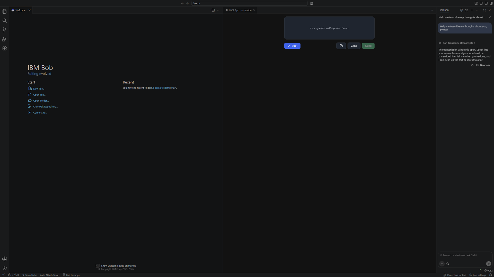
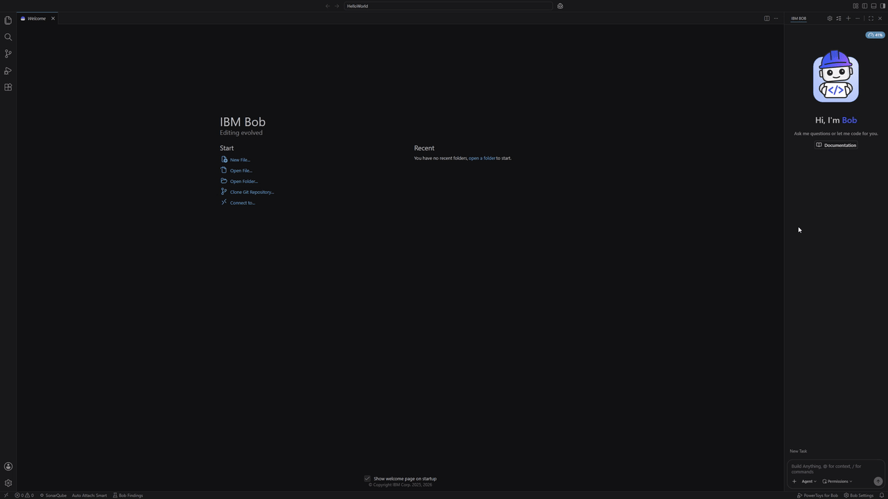

# PowerToys for Bob

Enhanced development tools for [IBM Bob](https://bob.ibm.com/): debugging, terminal access, multi-root workspace support, video analysis, and quality-of-life improvements.

## What is PowerToys for Bob?

PowerToys for Bob is an IBM Bob extension that **supercharges your development workflow**. It supports multi-root workspaces, letting Bob read, write, search files, and run commands across all your workspace folders seamlessly. It adds quality-of-life improvements like detaching the chat panel to a separate OS window and automatically restoring the last active task on reopen. It gives Bob direct access to your debugging sessions so it can set breakpoints, inspect variables, control execution, and read terminal output - all without manual copy-pasting. It can also extract and analyze frames from video files, so you can ask Bob to inspect recordings, screen captures, or any video directly.

> **Disclaimer:** PowerToys for Bob is a personal project. It is not affiliated with, endorsed by, or supported by IBM.

## Features

- **Breakpoint Management**: Set, remove, and list breakpoints with conditions
- **Debug Control**: Step through code, continue, pause, and stop debugging
- **Variable Inspection**: Evaluate expressions and inspect variables at any point
- **Stack Traces**: Get call stacks and navigate frames
- **Terminal Access**: Read and search terminal output
- **Automatic Breakpoint Notifications**: Bob is notified when breakpoints are hit
- **Multi-Root Workspace Support**: All built-in tools work on every workspace folder — no prompts, no reliance on "outside workspace" flags — plus cross-folder search tools
- **Video Analysis**: Extract and analyze frames from video files - ask Bob to inspect recordings, screen captures, or debug videos
- **MCP Apps (experimental)**: render interactive `ui://` app views from MCP servers in a side panel - Bob discards them natively
- **Open Task in New Window**: Detach Bob's chat panel to a separate OS window so you can move it to another monitor
- **Restore Last Task**: Bob automatically reopens the task you were working on when you restart the application

## Configuration

Access via: Bob Settings > Extensions > PowerToys for Bob

**Tools** — enable or disable entire groups of tools and configure specific tool options. Changes take effect on the next Bob turn, no restart required.

| Setting | Default | Controls |
|---|---|---|
| `bob-powertoys.tools.debug.enabled` | `true` | All debug and breakpoint tools (18 tools) |
| `bob-powertoys.tools.debug.breakpointNotifications` | `bobOnly` | Breakpoint hit notifications (`disabled`, `bobOnly`, `all`) |
| `bob-powertoys.tools.terminal.enabled` | `true` | Terminal tools (4 tools) |
| `bob-powertoys.tools.video.enabled` | `true` | Video analysis tools |
| `bob-powertoys.tools.extensions.enabled` | `true` | `list_extensions` tool |
| `bob-powertoys.mcpApps.enabled` | `false` | Experimental MCP Apps host: `ui://` views from MCP servers open in a side panel |

## Usage

Once installed, Bob automatically has access to all debugging and terminal tools. No additional configuration needed.

### Example Conversations

**Natural language debugging - just describe what you want to understand:**

> "I need to debug my API server to understand which user is making the database queries. Can you help me figure that out?"

> "The authentication is failing but I don't know why. Let's debug it and see what's happening with the user credentials"

> "Something's wrong with the payment processing. Can you attach to the checkout service and help me trace through what's happening?"

**Direct debugging requests:**

> "Set a breakpoint in the login handler when username is empty"

> "What's the current value of orderTotal in the shopping cart?"

> "Show me the call stack when the database connection fails"

> "Search the terminal for any TypeScript compilation errors"

## MCP Apps (experimental)

Some MCP servers ship an interactive UI alongside their tools — a form, a preview, a picker — that is meant to open when the tool runs. Bob normally discards these views. With this setting enabled, PowerToys intercepts the tool call and opens the UI in a side panel instead.

**How to use:** enable `bob-powertoys.mcpApps.enabled` in settings, then use any MCP tool that ships a UI. The panel opens automatically when Bob calls that tool.

**What works:**
- The UI can call back into the server's other tools and read its resources
- Links open in your browser
- The tool's arguments and result are passed to the UI automatically

**Known limitations:**
- Some strictly-conforming servers may not expose their UI to PowerToys because Bob does not advertise MCP Apps support during the connection handshake
- The UI sandbox uses a permissive default content-security-policy (a known limitation, being worked on)

## Quality of Life

### Open Task in New Window

Move Bob's chat panel to a separate OS window so you can place it on a second monitor while you keep coding in the main one.

**How to use:**
- Right-click anywhere inside Bob's chat panel and select **Open Task in Window**
- Or open the `...` menu in Bob's toolbar and select **New Task In Window** to start a fresh task in its own window

### Restore Last Task

When you close and reopen the application, Bob automatically reopens the task you were working on. No need to dig through history to find where you left off.

This works silently in the background: the save happens as you use Bob normally, and the restore happens at startup before you even interact with it.

## Multi-Root Workspace Support

When you open a Bob workspace with **multiple root folders at different paths on disk** (e.g. `...\src\frontend` and `...\src\backend` in the same `.code-workspace` file), Bob's built-in tools only consider the primary folder "inside the workspace". Every file in a secondary folder is treated as *outside the workspace*: blocked when *Allow outside workspace tool requests* is off, or gated behind approval prompts / auto-approve flags otherwise.

PowerToys for Bob fixes this at the source: a **multi-root sandbox patch** makes Bob's own outside-workspace check aware of every workspace folder. When a built-in tool (`read_file`, `write_file`, `list_files`, `glob`, `grep`, `insert_content`, `search_and_replace`, `apply_diff`, `execute_command`) is called with paths inside any workspace folder, the call is treated exactly like a primary-folder path — **no block, no prompt, and no need to touch Bob's flags**. Paths genuinely outside every folder keep Bob's native behavior unchanged.

Relative paths still resolve against the primary folder, so for secondary folders the model is guided (via a system-prompt hint) to use absolute paths, `../<folder>/...`, or `<folder>/...` — the latter is automatically resolved inside the named folder when it does not exist under the primary root. This covers every built-in path-carrying tool, including the symbol tools (`FindSymbol`, `FindReferencingSymbols`), whose language-server queries are also scoped to the right folder.

The only tool the extension adds on top is `list_workspace_folders` — it lets the model discover the root folders (Bob's environment info only shows the primary one) and is **automatically hidden** in single-root workspaces.

## Available Tools

Bob has access to **26 tools** organized in 7 categories. The active count depends on workspace type: in a single-root workspace `list_workspace_folders` is hidden, so Bob sees **25 tools**; in a multi-root workspace all 26 are visible.

### Debug (18 tools)
- `set_breakpoints` - Set multiple breakpoints with optional conditions
- `remove_breakpoints` - Remove multiple breakpoints
- `list_breakpoints` - List all active breakpoints
- `step_over` - Step over current line
- `step_into` - Step into function call
- `step_out` - Step out of current function
- `continue` - Continue execution
- `pause` - Pause execution
- `evaluate_expression` - Evaluate expressions in debug context
- `get_variables` - Get variables from a scope
- `get_stack_trace` - Get call stack
- `get_scopes` - Get variable scopes
- `set_variable` - Modify variable values
- `get_debug_output` - Get debug console output
- `get_active_debug_session` - Get active session info
- `list_debug_configurations` - List available debug configs
- `start_debug_session` - Start debugging
- `stop_debug_session` - Stop debugging

### Terminal Console (4 tools)
- `list_terminals` - List all open terminals
- `get_terminal_output` - Get recent terminal output
- `search_terminal_output` - Search terminal with regex
- `focus_terminal` - Bring terminal into focus

### Multi-Root Workspace (1 tool)

> This tool is **only active in multi-root workspaces** (2+ root folders). It is invisible to Bob in single-root workspaces. All the built-in file and symbol tools also work on every folder via the multi-root sandbox patch.

- `list_workspace_folders` - List all workspace root folders and their paths

### Video Analysis (1 tool)
- `read_video_file` - Extract frames from a video file for visual analysis. Works on every workspace folder (absolute path, or a relative path starting with a secondary folder name). Requires ffmpeg on PATH.

### Bob Extensions (1 tool)
- `list_extensions` - List all installed Bob extensions with optional filter by name or ID

For detailed tool documentation and parameters, see [DEVELOPMENT.md](DEVELOPMENT.md).

## Requirements

- IBM Bob 2.3.0 or higher
- Node.js 24.x or higher

## Development

See [DEVELOPMENT.md](DEVELOPMENT.md) for architecture details, development guide, and contribution guidelines.

## License

MIT

## Author

Pierpaolo Battaglione